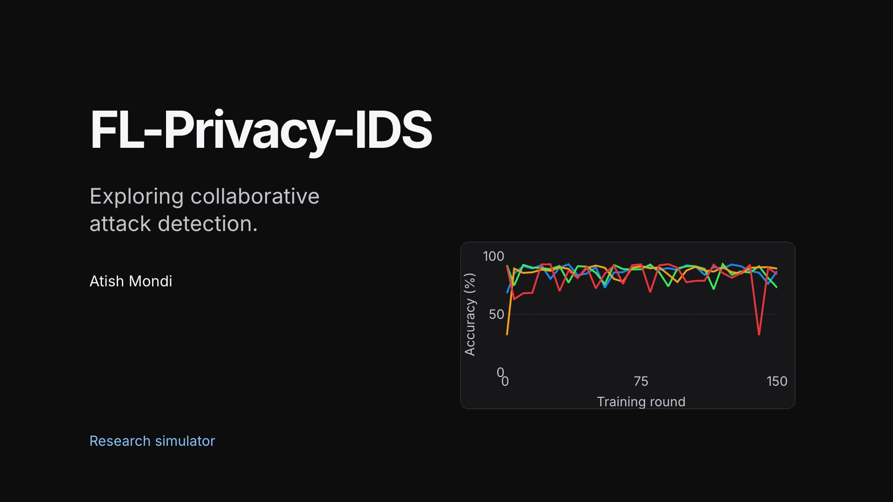

# FL-Privacy-IDS

**Exploring collaborative attack detection with federated learning.**

[](https://github.com/user-attachments/assets/f11108d5-841f-4d28-b001-1c22955056af)

*38-second walkthrough: simulated local training, four algorithm variants, and recorded experiment curves. The training animation is illustrative; the charts use saved experiment data.*

## About the project

FL-Privacy-IDS is a Python research project for binary intrusion detection using UNSW-NB15 network traffic records. It explores federated learning across simulated clients, data heterogeneity, and experimental differential privacy integration.

The project combines training scripts, round-by-round metric tracking, and a Streamlit results explorer. It is a single-machine research simulation, with validation still in progress.

## How it works

1. **Prepare network traffic records** for normal-versus-attack classification.
2. **Partition training data** across simulated clients using IID or Dirichlet-based non-IID splits.
3. **Train and aggregate models** using FedAvg, FedProx, FedOpt, or FedNova variants.
4. **Record and inspect results** using metric logs, summary files, and dashboard charts.

## Features

- Four federated algorithm implementations.
- IID and non-IID experiment tracks.
- Experimental Opacus integration for clipping and noise during local training.
- Accuracy, precision, recall, and F1 tracking.
- Interactive exploration of saved runs.

**Stack:** Python · PyTorch · Opacus · scikit-learn · pandas · Streamlit · Plotly

## Repository guide

| Path | Purpose |
| --- | --- |
| `src/preprocess.py` | Loads, prepares, and partitions data. |
| `src/models.py` | Defines the intrusion detection model. |
| `src/fl_algorithms/` | Implements the federated training variants. |
| `src/dp_wrapper.py` | Integrates Opacus into local training. |
| `experiments/` | Runs baseline, non-IID, and privacy experiments. |
| `dashboard/app.py` | Explores saved experiment results. |

## Running the project

The experiment entry points are `experiments/run_baseline.py`, `experiments/run_noniid.py`, and `experiments/run_dp.py`. Run them from the repository root in an environment containing the project dependencies.

The preprocessing pipeline expects the UNSW-NB15 CSV files under `data/unsw_nb15/`. Obtain the dataset separately under its usage terms. Generated CSVs and the `results/` directory are excluded from version control, so a fresh clone does not include the recorded runs shown in the video.

Once result files are available, launch the explorer with:

```bash
streamlit run dashboard/app.py
```

Dependency pinning and a verified fresh-install workflow remain to be completed.

## Status and limitations

**Research prototype. The saved results are exploratory and do not establish a validated privacy guarantee or a definitive algorithm ranking.**

- Privacy accounting needs composition across repeated client participation; reported local-session epsilon values are not a whole-run privacy budget.
- The DP wrapper's optimizer handling and the interaction between FedProx regularization and per-sample gradients need correction and verification.
- Non-IID partitioning needs stronger checks for overlapping samples and clients with no usable training batches.
- Preprocessing and checkpoint selection need an independent validation protocol, followed by repeated-seed experiments.
- Algorithm implementations and experiment settings need further consistency checks before comparison with published benchmarks.

The project does not currently provide live packet ingestion or a production multi-machine federation.

## Author

[Atish Mondi](https://github.com/Atishmondi)
